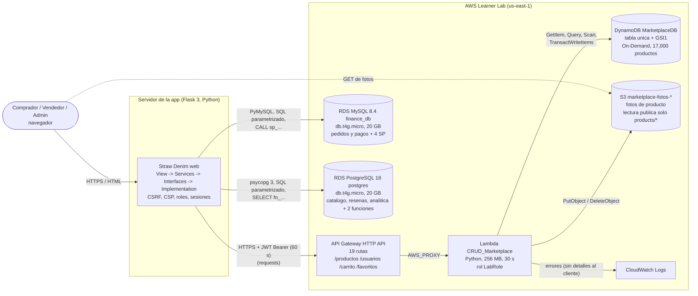
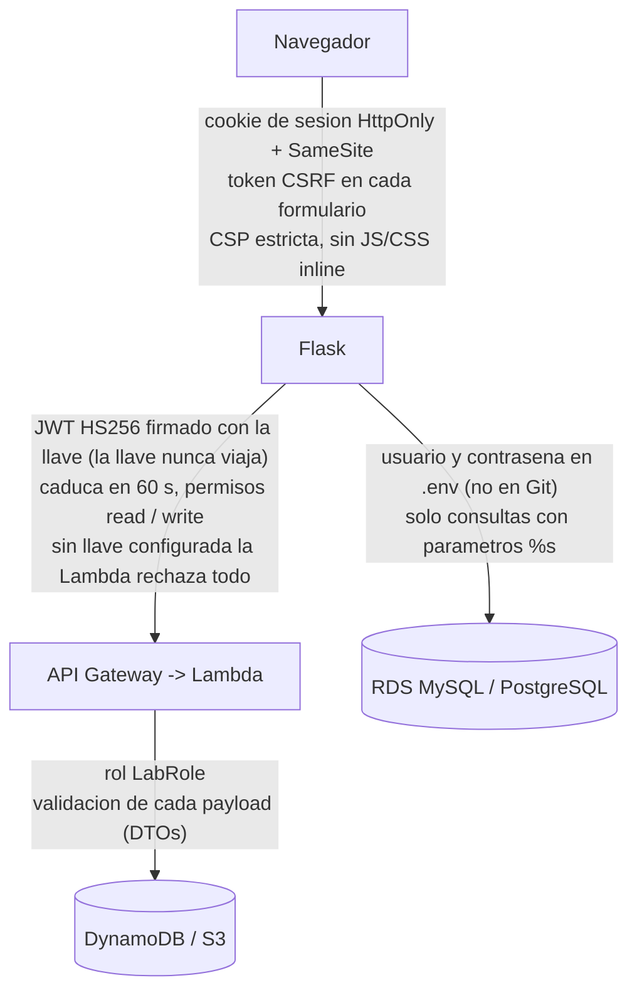
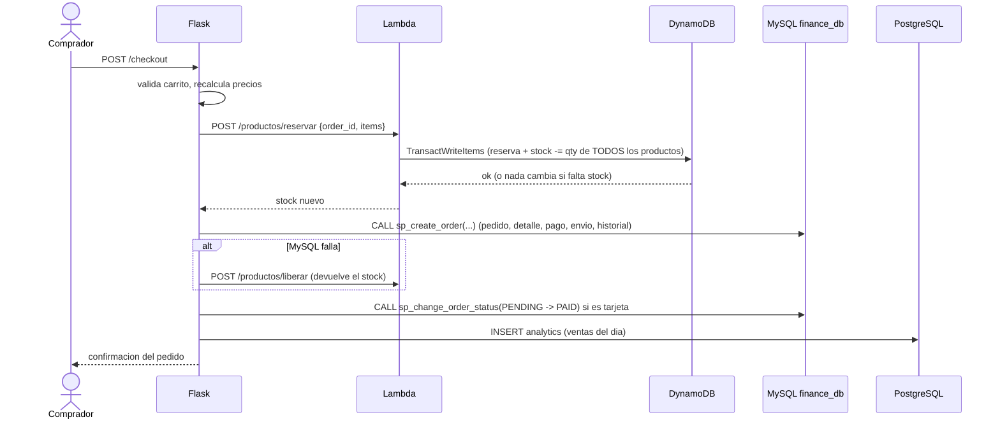
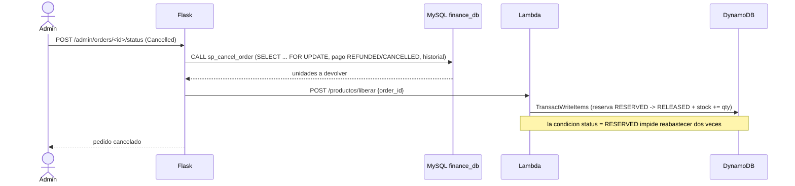

# Arquitectura en AWS (Learner Lab)

Región **us-east-1**. Todo corre con el rol preconfigurado **LabRole** (sin roles ni políticas IAM
propias) y con recursos del tamaño que permite el laboratorio.

## 1. Vista de contenedores (C4 nivel 2)

| Componente | Configuración | Por qué |
|---|---|---|
| **API Gateway** (HTTP API) | 19 rutas, **todas exigen un JWT**, todas a la misma integración de la Lambda, etapa con auto-deploy, **límite de 50 peticiones/s (ráfagas de 100)** | Un solo punto de entrada a DynamoDB/S3; la app no guarda credenciales de AWS |
| **Lambda** `CRUD_Marketplace` | Python, **256 MB**, timeout 30 s, rol **LabRole**, variables `MARKETPLACE_TABLE`, `MARKETPLACE_GSI`, `MARKETPLACE_API_KEY`, `MARKETPLACE_BUCKET` | Límite del lab: 128-256 MB; solo esta API puede invocarla |
| **DynamoDB** `MarketplaceDB` | On-Demand, PK/SK + GSI1 | Catálogo masivo y transacciones rápidas; sin capacidad aprovisionada que gaste crédito |
| **S3** | Bloqueo de ACLs, política de solo lectura de `products/*` | Las fotos se leen directo del bucket; subir y borrar solo lo hace la Lambda |
| **RDS MySQL** `db-finance` | `db.t4g.micro`, 20 GB, almacenamiento cifrado; Security Group: puerto 3306 solo para la IP del equipo de desarrollo | Datos financieros con transacciones ACID y stored procedures |
| **RDS PostgreSQL** `db-operations` | `db.t4g.micro`, 20 GB, almacenamiento cifrado; Security Group: puerto 5432 solo para la IP del equipo de desarrollo | Catálogos, reseñas y analítica con funciones de reporte |
| **CloudWatch** | Logs de la Lambda | Los errores internos se registran ahí; al cliente solo le llega `Internal error.` |

**Configuración sin direcciones fijas:** la app lee todos los endpoints de `.env` (`API_URL`, `MYSQL_HOST`,
`PG_HOST`, `PRODUCT_IMAGES_URL`), así que cuando el laboratorio cambia algo solo se edita ese archivo.
`scripts/aws_deploy.py` lee las **credenciales temporales** del Learner Lab (`AWS_ACCESS_KEY_ID`,
`AWS_SECRET_ACCESS_KEY`, `AWS_SESSION_TOKEN`) para desplegar sin clics.

**Ahorro de crédito:** RDS de clase micro con 20 GB que se apagan al terminar de trabajar
(`--start-rds` para encenderlas); DynamoDB On-Demand; Lambda de 256 MB que solo cobra cuando se usa.

## 2. Seguridad en cada conexión

## 3. Flujo de compra (transacción atómica + stored procedure)

## 4. Flujo de cancelación

Más detalle: [DIAGRAMA_ER.md](DIAGRAMA_ER.md), [STORED_PROCEDURES.md](STORED_PROCEDURES.md),
[DESPLIEGUE_AWS.md](DESPLIEGUE_AWS.md), [openapi.yaml](openapi.yaml).
