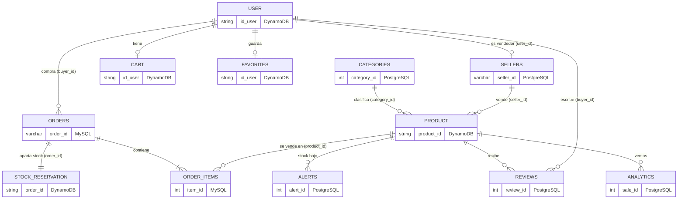
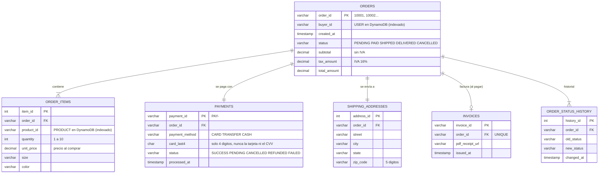
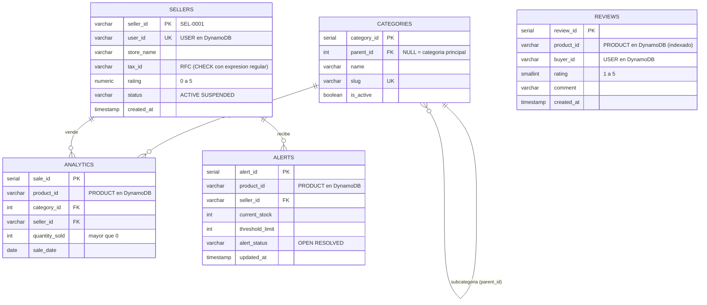
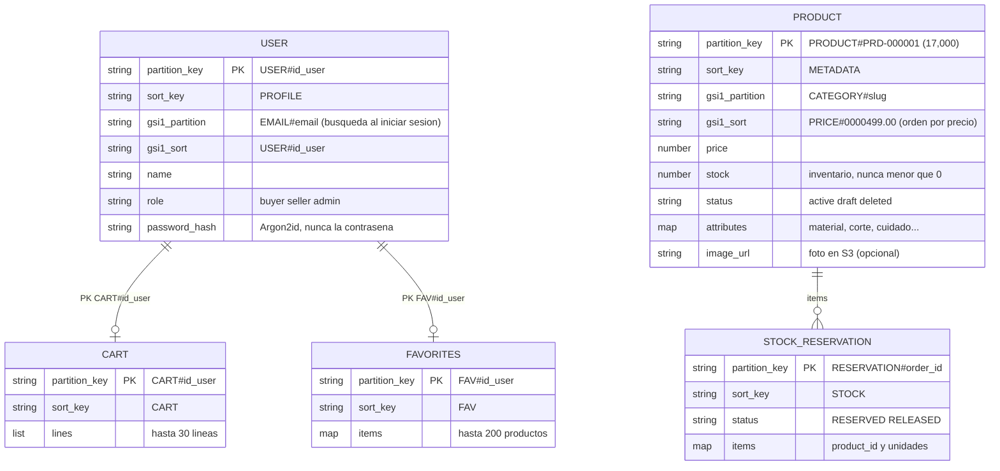

# Diagrama Entidad-Relación (DER)

Straw Denim usa un **diseño híbrido de 3 bases de datos**. Cada dato vive en la base que mejor le queda:

| Base | Motor | Entidades |
|---|---|---|
| `MarketplaceDB` | **DynamoDB** (tabla única, On-Demand) | Usuarios, Productos (con su inventario), Carritos, Favoritos, Reservas de stock |
| `finance_db` | **MySQL 8** (RDS) | Pedidos, Detalle de pedido, Pagos, Direcciones de envío, Facturas, Historial de estados |
| `postgres` | **PostgreSQL 18** (RDS) | Categorías, Vendedores, Reseñas, Analítica de ventas, Alertas de inventario |

**16 entidades** en total (la rúbrica pide al menos 10). Las líneas continuas son llaves foráneas reales
(la base las hace cumplir); las relaciones entre bases distintas son **lógicas**: las cuida la aplicación
(los ids `PRD-000001`, `SEL-0001`, `u-ana00001` son los mismos en las tres bases).

> Los diagramas están en Mermaid: GitHub los dibuja al abrir este archivo. Se pueden copiar en
> <https://mermaid.live> para exportarlos como imagen.

---

## 1. Vista general entre las tres bases

---

## 2. MySQL `finance_db` (transaccional: pedidos y pagos)

Todas las tablas hijas apuntan a `orders` con `FOREIGN KEY ... ON DELETE CASCADE`.
Índices extra: `idx_orders_buyer_created (buyer_id, created_at)`, `idx_orders_status_created (status, created_at)`,
`idx_order_items_product (product_id)`. Escrituras solo por stored procedures (`sp_create_order`,
`sp_change_order_status`, `sp_cancel_order`).

---

## 3. PostgreSQL (operaciones: catálogo, vendedores y analítica)

Índices: `idx_reviews_product (product_id)`, `idx_analytics_seller_date (seller_id, sale_date)`,
`idx_alerts_seller (seller_id, alert_status)`; únicos: `categories.slug`, `sellers.user_id`,
`reviews (product_id, buyer_id)`. Funciones: `fn_seller_sales_history`, `fn_seller_units_by_day`.

`reviews` tiene la restricción `UNIQUE (product_id, buyer_id)`: una reseña por comprador y producto.

---

## 4. DynamoDB `MarketplaceDB` (tabla única)

Una sola tabla con llave compuesta **PK + SK** y un índice global **GSI1 (GSI1PK, GSI1SK)**
(en el diagrama: `partition_key`, `sort_key`, `gsi1_partition`, `gsi1_sort`).
Esquema exacto: [`database/dynamodb_schema.json`](../database/dynamodb_schema.json); entidades y
patrones de acceso: [`database/dynamodb_entities.json`](../database/dynamodb_entities.json).

